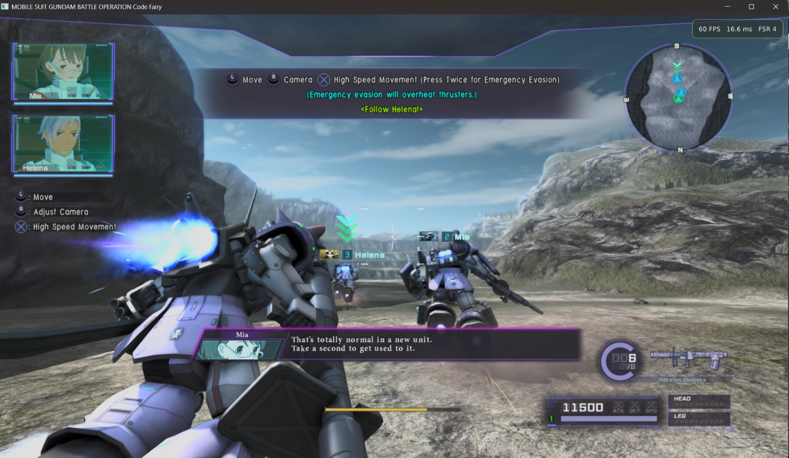
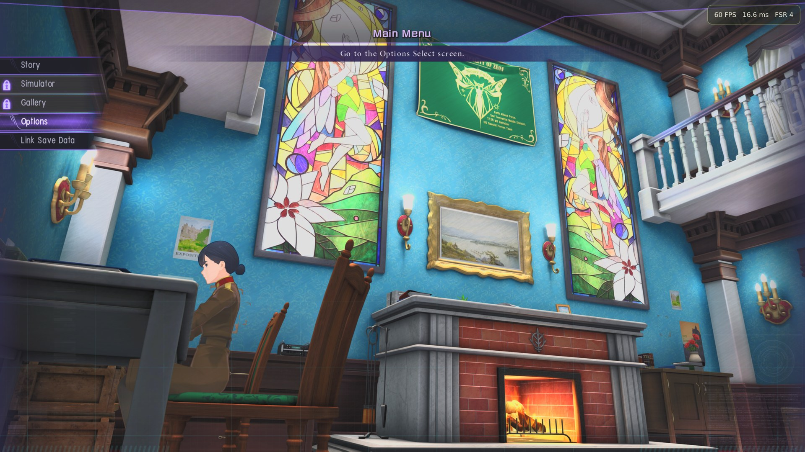
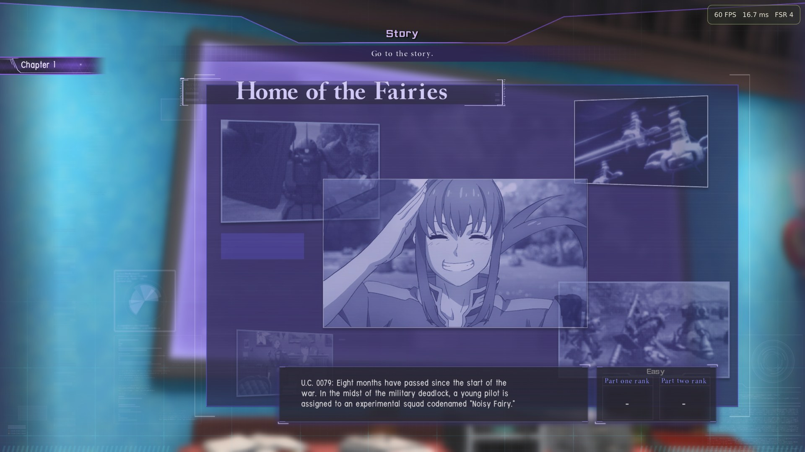
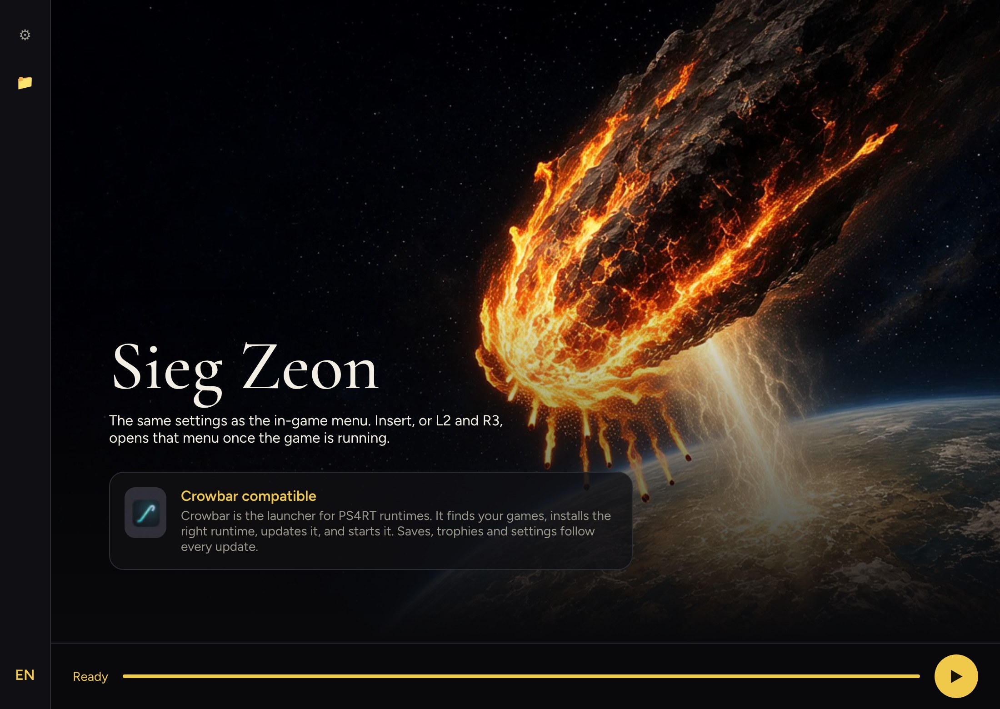
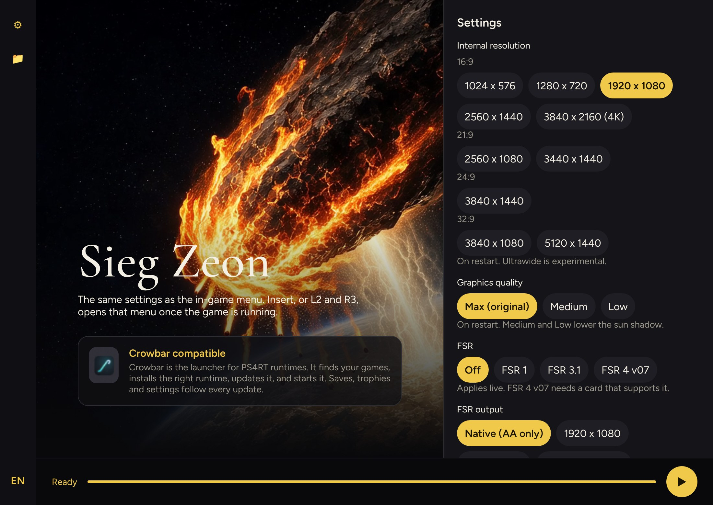

# GBO-Code-Fairy-PS4RT-Windows

Portage Windows de [GBO-Code-Fairy-PS4RT](https://github.com/HekamiAeon/GBO-Code-Fairy-PS4RT), d’après la branche `main` en amont, commit `0252c9dda14ee0e00a3688585a3e6f43fdf16ead`. C’est la release **v1.0** (`49ea9f001022d81c2ae4fb6aaaa42684bbeff16c`) plus deux commits : une indication en cas de plantage du cache de pipelines sous Linux, et son test. La branche `windows` est la branche par défaut.

Publié par [DiamondDogz](https://github.com/DiamondDogz). Le lanceur est `SiegZeon.exe`.

Le jeu est *MOBILE SUIT GUNDAM BATTLE OPERATION Code Fairy*, PlayStation 4, identifiant **CUSA28763**, version du jeu **01.03**. La version du jeu n’est pas celle de ce portage.

Non officiel. Aucun lien avec Bandai Namco, Sunrise ou Sony. Le jeu n’est pas inclus.

**Préversion.** [windows-1.0](https://github.com/DiamondDogz/GBO-Code-Fairy-PS4RT-Windows/releases/tag/windows-1.0) démarre le jeu et on y joue, mais il faut plus d’essais avant une version stable. Signalez ce qui casse dans les [issues](https://github.com/DiamondDogz/GBO-Code-Fairy-PS4RT-Windows/issues).

Testé sur Windows 11 Professionnel pour les Stations de travail, version 26H2, un Intel Core i9-12900KF, 128 Go de DDR5 à 4000 MT/s, et une NVIDIA GeForce RTX 3090 24 Go. C’est la machine de test, pas un minimum.

English version: [README.md](README.md).

## Ce que contient cette branche

- Le source du runtime v1.0, plus `main` en amont, avec les changements Windows nécessaires pour le démarrer.
- `SiegZeon.exe`, `launcher/siegzeon/` et `python/`, le Python embarqué qui fait tourner le lanceur et les scripts de préparation.
- `bin/ps4rt.exe`, compilé depuis cette branche, et les bibliothèques qu’il importe.
- `bin/ps4rt-pkg.exe`, l’extracteur utilisé pour la mise à jour et les clés de volume.
- `crowbar.json` : ce runtime est compatible [Crowbar](https://github.com/DiamondDogz/crowbar). Crowbar peut le lancer et enregistre les trophées que le jeu débloque.
- [INSTALL.md](INSTALL.md), [CREDITS.md](CREDITS.md) et [AI.md](AI.md).

Seul le jeu doit être un dossier extrait. La mise à jour et les trois clés de volume restent des fichiers PKG : le lanceur les installe.

## Installation

Le détail est dans [INSTALL.md](INSTALL.md). En bref :

1. Windows 10 ou 11, 64 bits, avec Microsoft Edge WebView2 et un pilote Vulkan récent.
2. Votre propre dossier CUSA28763 extrait. S’il est encore en 01.00, votre propre PKG de mise à jour 01.03.
3. Vos propres trois PKG de clés de volume, dans un seul dossier. Ils débloquent les trois épisodes déjà présents dans le jeu.
4. Décompressez l’archive. Ouvrez `SiegZeon.exe`, à la racine.
5. Ouvrez Dossiers (📁) : le dossier du jeu, le PKG de mise à jour s’il le faut, le dossier des PKG de clés de volume. Appuyez sur ▶.

## Lanceur

L’anglais est la langue du lanceur. Le bouton EN passe au français, et le choix est retenu. Les panneaux Réglages (⚙) et Dossiers (📁) sont fermés au démarrage. Un second clic sur l’icône, ou Échap, les referme.

Les réglages sont ceux du menu en jeu. En jeu, Insert, ou L2 et R3, ouvre ce menu.

`SiegZeon.exe` n’est pas signé. SmartScreen peut prévenir. Ne désactivez pas Microsoft Defender.

## Avertissement

Oui, une bonne partie de tout ça est de l’AI slop. À prendre ou à laisser.

Environ 90 % du code du portage Windows a été écrit avec Grok. Claude est arrivé ensuite : il a trouvé pourquoi le jeu plantait au premier combat, a fait le ménage, et a écrit les langues du lanceur, les fichiers Crowbar et ces pages. Voir [AI.md](AI.md).

## Crédits

Le runtime est [HekamiAeon, GBO-Code-Fairy-PS4RT](https://github.com/HekamiAeon/GBO-Code-Fairy-PS4RT). Ce portage Windows est publié par [DiamondDogz](https://github.com/DiamondDogz). Environ 90 % du code du portage Windows a été écrit avec [Grok](https://grok.com), de xAI. Le reste, les langues du lanceur et ces documents ont été écrits avec [Claude](https://claude.ai), d’Anthropic. Voir [CREDITS.md](CREDITS.md) et [AI.md](AI.md).

## Licence

GPL-2.0-or-later, les mêmes termes que le runtime. Les composants tiers gardent leurs propres notices. Voir [CREDITS.md](CREDITS.md).

Aucune garantie.

Le README Linux d’origine est gardé dans [docs/README-upstream-linux.md](docs/README-upstream-linux.md). Le projet en amont est [HekamiAeon/GBO-Code-Fairy-PS4RT](https://github.com/HekamiAeon/GBO-Code-Fairy-PS4RT).
