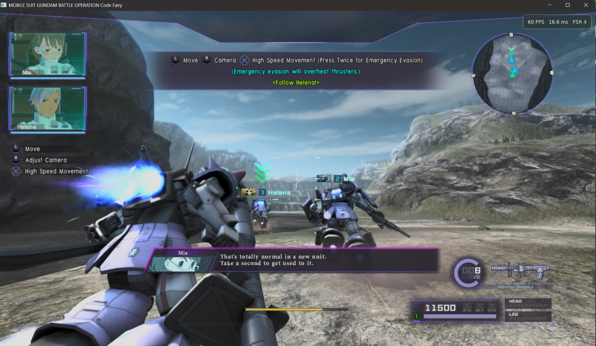
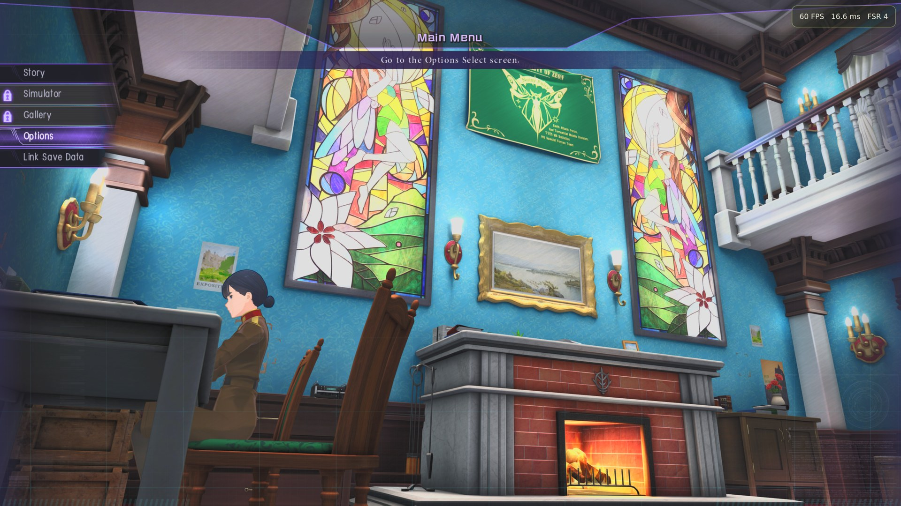
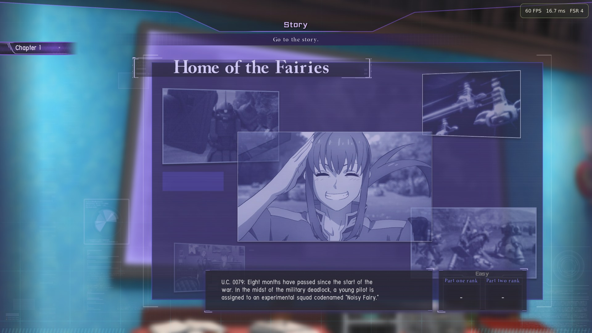
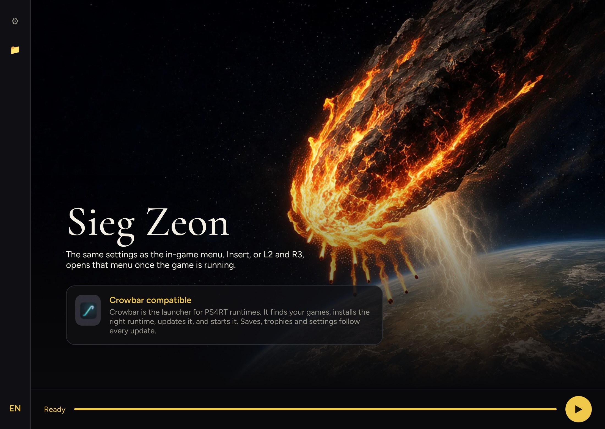
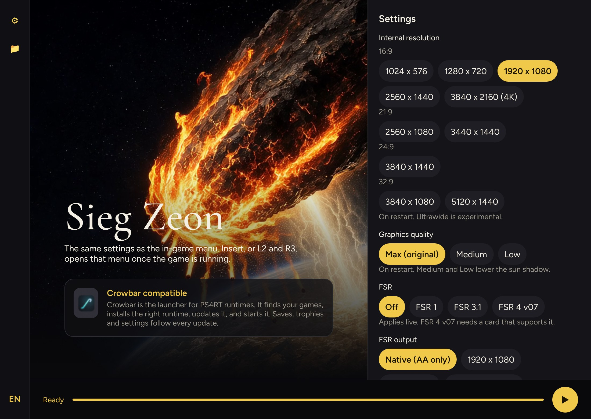

# GBO-Code-Fairy-PS4RT-Windows

Windows port of [GBO-Code-Fairy-PS4RT](https://github.com/HekamiAeon/GBO-Code-Fairy-PS4RT), built from upstream `main`, commit `0252c9dda14ee0e00a3688585a3e6f43fdf16ead`. That is the **v1.0** release (`49ea9f001022d81c2ae4fb6aaaa42684bbeff16c`) plus two commits: a crash hint for the Linux pipeline cache and its test. The branch `windows` is the default branch.

Published by [DiamondDogz](https://github.com/DiamondDogz). The launcher is `SiegZeon.exe`.

The game is *MOBILE SUIT GUNDAM BATTLE OPERATION Code Fairy*, PlayStation 4, title id **CUSA28763**, game version **01.03**. The game's version is a separate number from this port's.

Unofficial. Not affiliated with Bandai Namco, Sunrise or Sony. The game is not included.

**Latest release:** [windows-1.0.2](https://github.com/DiamondDogz/GBO-Code-Fairy-PS4RT-Windows/releases/tag/windows-1.0.2). With [Crowbar](https://github.com/DiamondDogz/crowbar), the Guide button pauses the game, Quit closes it cleanly, and the trophy test profile can unlock a trophy through the runtime. Report what breaks in the [issues](https://github.com/DiamondDogz/GBO-Code-Fairy-PS4RT-Windows/issues).

Tested on Windows 11 Pro for Workstations, version 26H2, an Intel Core i9-12900KF, 128 GB of DDR5 at 4000 MT/s, and an NVIDIA GeForce RTX 3090 24 GB. That is the test machine, not a minimum.

Version française : [README.fr.md](README.fr.md).

## What is in this branch

- The v1.0 runtime source, plus upstream `main`, with the Windows changes needed to start it.
- `SiegZeon.exe`, `launcher/siegzeon/`, and `python/`, the embedded Python that runs the launcher and the setup scripts.
- `bin/ps4rt.exe`, built from this branch, and the libraries it imports.
- `bin/ps4rt-pkg.exe`, the extractor used for the update and the volume keys.
- `crowbar.json`: this runtime is [Crowbar](https://github.com/DiamondDogz/crowbar) compatible. Crowbar can start it, records the trophies the game unlocks, and pauses it from its Guide menu (`src/runtime_crowbar_pause.c`).
- [INSTALL.md](INSTALL.md), [CREDITS.md](CREDITS.md), and [AI.md](AI.md).

Only the game must be an extracted folder. The update and the three volume keys stay PKG files: the launcher installs them.

## Install

See [INSTALL.md](INSTALL.md). Short form:

1. Windows 10 or 11, 64-bit, with Microsoft Edge WebView2 and a current Vulkan driver.
2. Your own extracted CUSA28763 folder. If it is still 01.00, your own 01.03 update PKG.
3. Your own three volume key PKGs, in one folder. They unlock the three episodes already in the game.
4. Unzip the archive. Open `SiegZeon.exe`, at the root.
5. Open Folders (📁): the game folder, the update PKG if you need it, the folder of volume key PKGs. Press ▶.

## Launcher

English is the launcher language. The EN button switches to French, and the choice is remembered. The settings (⚙) and folders (📁) panels start closed. Click the icon again, or press Escape, to close them.

The settings are the same as the in-game menu. In the game, Insert, or L2 and R3, opens that menu.

`SiegZeon.exe` is not signed. SmartScreen may warn. Do not turn off Microsoft Defender.

## Disclaimer

Yes, a lot of this is AI slop. Take it or leave it.

About 90% of the Windows port code was written with Grok. Getting a build that actually reaches a battle took a long string of crashes, empty buffers and traces. The shoggoth is still a good one. Claude is not a second one. Claude is the relative who arrived later, found the missing gigabyte in `game_ss.cpk`, cleaned up, and brought the languages, the Crowbar files and these pages. The publisher is the key and the gate. See [AI.md](AI.md).

## Credits

The runtime is [HekamiAeon, GBO-Code-Fairy-PS4RT](https://github.com/HekamiAeon/GBO-Code-Fairy-PS4RT). This Windows port is published by [DiamondDogz](https://github.com/DiamondDogz). About 90% of the Windows port code was written with [Grok](https://grok.com), by xAI. The rest, the launcher languages and these documents were written with [Claude](https://claude.ai), by Anthropic. See [CREDITS.md](CREDITS.md) and [AI.md](AI.md).

## License

GPL-2.0-or-later, the same terms as the runtime. Third-party pieces keep their own notices. See [CREDITS.md](CREDITS.md).

There is no warranty.

The original Linux README is kept as [docs/README-upstream-linux.md](docs/README-upstream-linux.md). The upstream project is [HekamiAeon/GBO-Code-Fairy-PS4RT](https://github.com/HekamiAeon/GBO-Code-Fairy-PS4RT).
